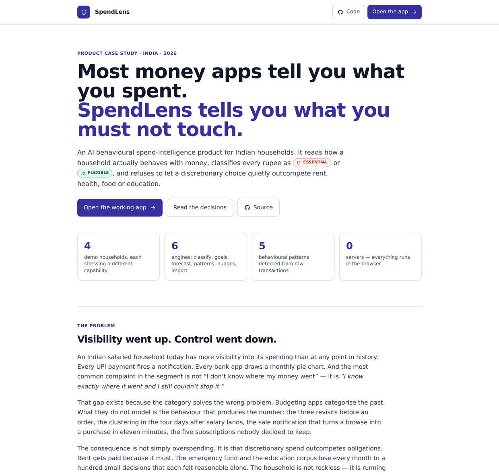
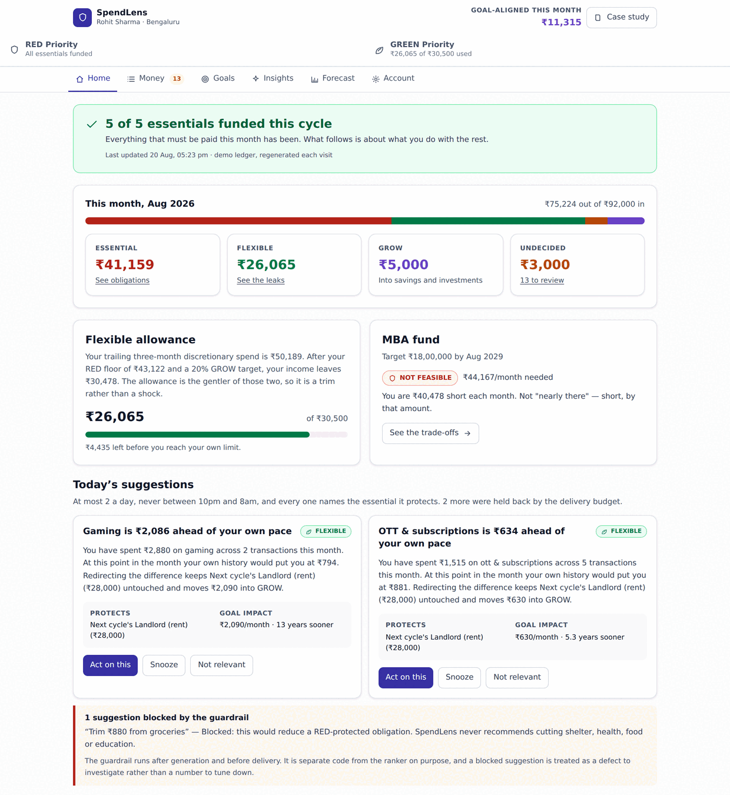
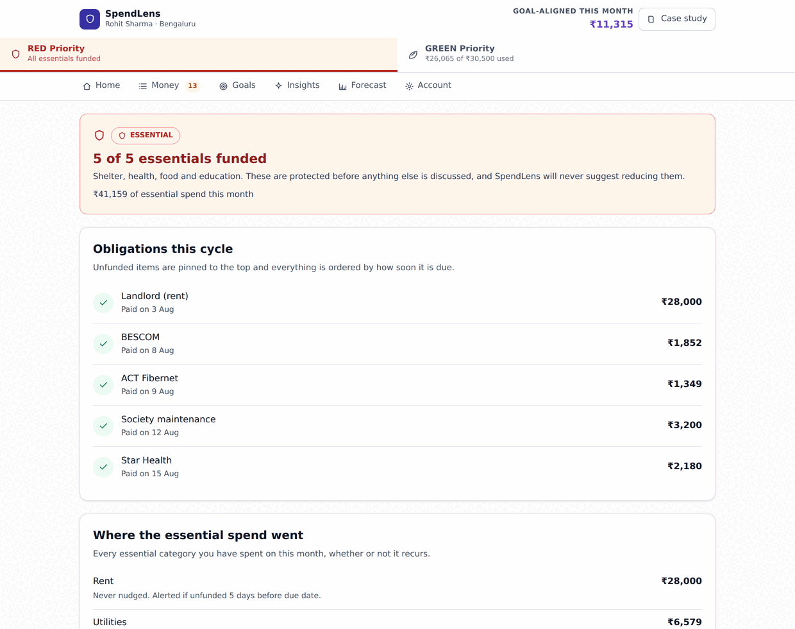
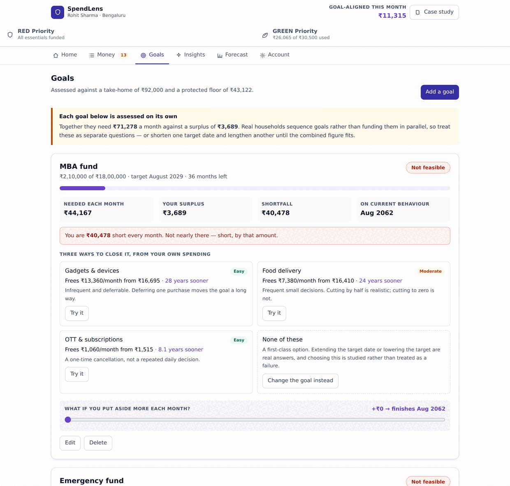
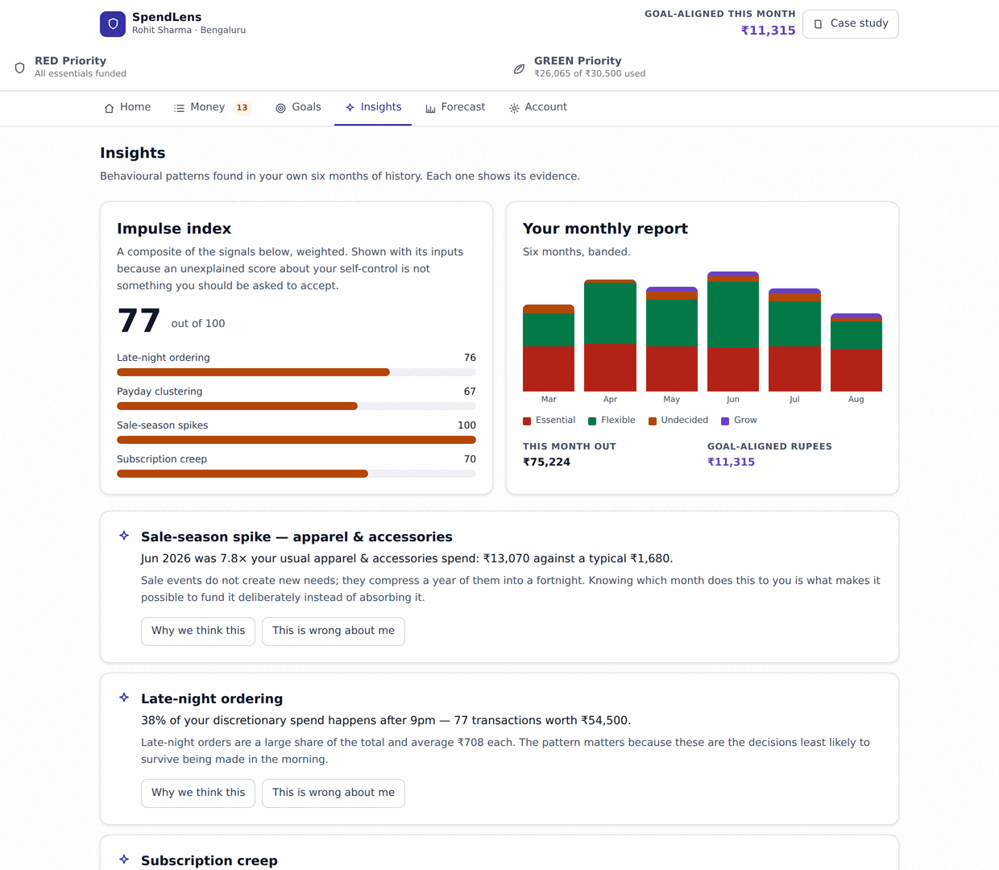
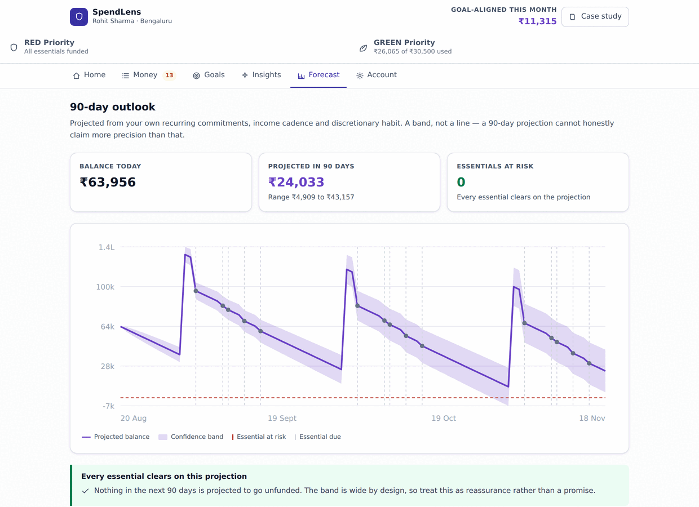

<div align="center">

# SpendLens

**Behavioural spend intelligence for Indian households.**

Most money apps tell you what you spent. SpendLens tells you what you must not touch.

[**Live demo →**](https://akr246.github.io/spendlens-ai-spend-intelligence/) · [Case study](https://akr246.github.io/spendlens-ai-spend-intelligence/#/case-study) · [Open the app](https://akr246.github.io/spendlens-ai-spend-intelligence/#/app)



</div>

---

## What it is

An AI behavioural spend-intelligence product for Indian households, built end to end as a working web app. It reads how a household actually behaves with money, classifies every rupee into one of four priority bands, refines stated financial goals into a monthly plan, and refuses to let a discretionary choice quietly outcompete rent, health, food or education.

Everything runs client-side. There is no server, no account, no network call, and no analytics — which is also the only honest architecture for a demo that invites you to import a real bank statement.

| | |
|---|---|
| **Bands** | `RED` essential · `GREEN` flexible · `AMBER` undecided · `GROW` toward goals |
| **Households** | 4 synthetic Indian personas, each stressing a different capability |
| **Engines** | classification, goals, forecasting, pattern detection, nudging, CSV import |
| **Stack** | React 18 · TypeScript · Vite · Tailwind · hand-rolled SVG charts · zero chart deps |
| **Deploy** | GitHub Actions → GitHub Pages, static |

---

## The one rule

> SpendLens never recommends reducing a RED-protected obligation. Not medicine, not school fees, not the health premium, not rent.

This is enforced by a **guardrail service** that evaluates every recommendation *after* generation and *before* delivery — deliberately separate code from the ranker. The app ships an intentionally unsafe candidate suggestion (`Trim ₹X from groceries`) so you can watch the guardrail block it on the home screen and see the block reason.

A product that reads a household's finances and then suggests cutting a diabetes prescription to fund an index fund has not made a small error of judgement. So the rule lives in code, not in a prompt.

---

## Screens

| Home — am I safe this month? | RED priority — obligations by days-to-due |
|---|---|
|  |  |

| Goals — verdict, gap, trade-offs | Insights — patterns with their evidence |
|---|---|
|  |  |



---

## How it works

### The taxonomy is the single source of truth

`src/data/taxonomy.ts` holds 29 leaf categories, each with an explicit classification rule, the product behaviour attached to it, and whether the user may move it between bands. Nothing else in the codebase is allowed to define a band — the classifier, the navigation, the analytics and the case study all read from this one file.

### Six engines

| File | Does | The interesting part |
|---|---|---|
| `engine/classify.ts` | Merchant registry → narration patterns → taxonomy → user overrides | Returns an **explanation trace**, not a score, so the UI renders a real "why we think this" listing the actual decision path |
| `engine/goals.ts` | Turns a goal into a required monthly figure, a verdict and ranked trade-offs | Trade-offs come from the household's own categories, ranked by **behavioural ease** rather than by size |
| `engine/forecast.ts` | 90-day balance path from recurring commitments and income cadence | Uncertainty widens with `√t`; incomes with >25% variance switch to a 30th-percentile envelope and the UI says so |
| `engine/patterns.ts` | Payday clustering, late-night, weekend, sale spikes, subscription creep | Immaterial patterns are computed, scored, and **deliberately not promoted** |
| `engine/nudges.ts` | Ranks candidates, then an independent guardrail vetoes unsafe ones | Hard delivery budget: 2/day, 8/week, never 22:00–08:00 |
| `engine/csv.ts` | Imports real Indian bank statements | Handles single-amount *and* separate withdrawal/deposit layouts, plus `dd/mm/yyyy` |

### The demo data is generated, not hardcoded

`src/data/seed.ts` builds ~6 months of transactions per persona from a seeded PRNG, so the ledger is identical on every load. The generator deliberately *encodes* the behaviours the engines look for — a 42% late-night bias in food delivery, clustering in the five days after salary, two sale-season retail spikes, subscriptions accumulating over time — so the pattern detector is finding something real rather than displaying a canned answer.

### Comparisons are pro-rated, and always against yourself

On the 20th of a month you have lived two-thirds of it. Comparing a partial month against a full-month median would tell every user, every month, that they were doing brilliantly until the last week. Every "you are ahead of your usual pace" figure in the app is pro-rated by `paceFactor()`, and the baseline is always the household's own trailing median — never a population average, because the income bands in this market are too different for that to mean anything.

---

## Product decisions worth arguing about

1. **Goal-first onboarding, before asking for bank access.** Delays time-to-value. Taken anyway: a user who has already said what they are worried about has a reason to finish the consent step that follows.
2. **Ask instead of guessing.** Low-confidence transactions go to an AMBER review queue rather than being shown as fact. A review queue looks like unfinished work; a confident wrong band in a product that knows your rent is due is unrecoverable.
3. **Say the number.** A verdict of *Not feasible* says Not feasible, with the gap in rupees. Encouraging phrasing tests better in the moment and destroys the only thing a feasibility verdict is for.
4. **A hard nudge budget.** Caps the engagement metric every growth conversation reaches for first. Nudge fatigue removes users faster than any missing feature.
5. **Trade-offs ranked by behavioural ease, not size.** Cutting gifting is arithmetically efficient and culturally illiterate, so it ranks last — and *"none of these"* is a first-class option.
6. **No moralising vocabulary.** The words are `ESSENTIAL` and `FLEXIBLE`, never "good spend" and "bad spend". Festival and family spending is forecast and funded, not flagged.

---

## Accessibility and craft

- **Meaning never rides on colour alone.** Every band is colour **+** icon **+** word. Roughly one man in twelve cannot separate the red and green tokens by hue.
- **Contrast is specified, not eyeballed.** Every band token carries a measured ratio against its stated background; interactive targets are 44pt minimum, including chart data points.
- **Indian number formatting throughout** — `₹1,50,000`, never `150,000`. Tabular figures everywhere currency appears.
- **Forecasts are confidence bands, never single lines.**
- **`prefers-reduced-motion`** collapses animation to an instant cut.

---

## Running it

```bash
npm install
npm run dev            # http://localhost:5173
npm run build          # type-check + production build to dist/
npm run preview        # serve the production build
npm run lint:types     # tsc --noEmit
```

### End-to-end checks

Behaviour checks rather than snapshots — they verify that the consent gate actually gates, that a correction propagates to every transaction from that merchant, that the guardrail blocks the unsafe suggestion before delivery, and that a variable income switches to the conservative envelope.

```bash
npm run build
npx vite preview --port 4173 &
npm i -D playwright && npx playwright install chromium
npm run test:e2e
```

Playwright is intentionally *not* a committed dependency — its postinstall pulls browser binaries, which would slow every CI run of a static site build.

---

## Deploying

`.github/workflows/deploy.yml` builds and publishes to GitHub Pages on every push to `main`. The workflow passes the repository name as Vite's `base`, so the build works at `https://<user>.github.io/<repo>/` without editing anything.

1. Push to `main`.
2. **Settings → Pages → Build and deployment → Source: GitHub Actions.**
3. The first run publishes the site; subsequent pushes update it.

For a custom domain or a root deploy, build with `BASE_PATH=/`.

Routing uses `HashRouter` on purpose: GitHub Pages serves static files with no rewrite rule, so a deep link to `/goals` under `BrowserRouter` would 404 on refresh.

---

## What this build is not

Read this before judging it as a product:

- **No Account Aggregator integration.** Real ingestion needs a licensed NBFC-AA, a consent artefact and an immutable audit trail — none of which can live in a static site. The consent screens model the flow; they do not implement it.
- **The classifier is the rule layer only.** In the specification an ML model handles the residue. The rule layer exists precisely because it is shippable alone, which is what makes this demo honest rather than a mock.
- **No investment guidance.** SEBI Investment Adviser regulation gates personalised investment advice in India. Building it before a written legal opinion would be the expensive kind of optimism.
- **Every figure is a planning assumption** — targets, incomes, ceilings, ease ratings — chosen to make the models work end to end. None of it is researched market data.
- **Nothing here is financial advice.**

---

## Project structure

```
src/
├── data/          taxonomy · merchant registry · personas · seeded ledger generator
├── engine/        classify · analytics · goals · forecast · patterns · nudges · csv
├── store/         React context + localStorage persistence
├── components/    shell + priority menu bar · band chips · SVG charts · UI primitives
└── pages/         case study · onboarding · dashboard · RED · GREEN · money · goals
                   · insights · forecast · account
```

---

## Licence

MIT. All data is synthetic and stays in your browser.

*SpendLens is a portfolio product build. Not a financial product, not financial advice, and not affiliated with any bank or aggregator.*
